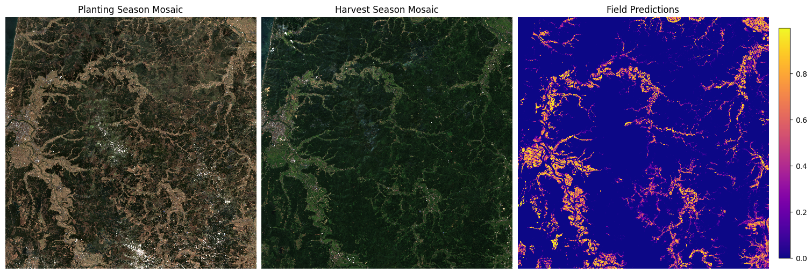
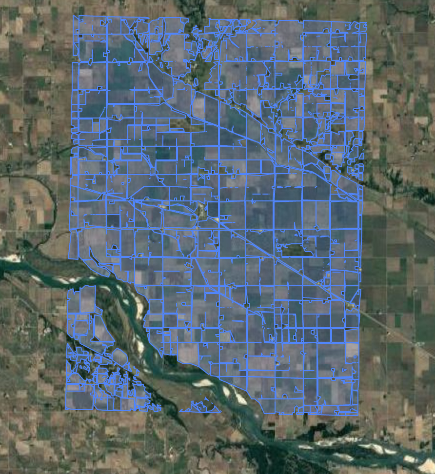
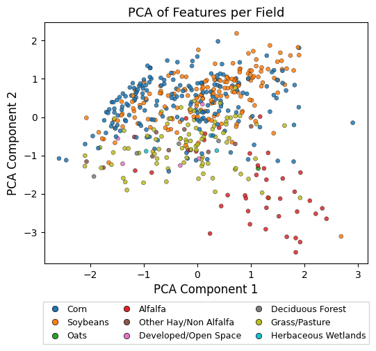
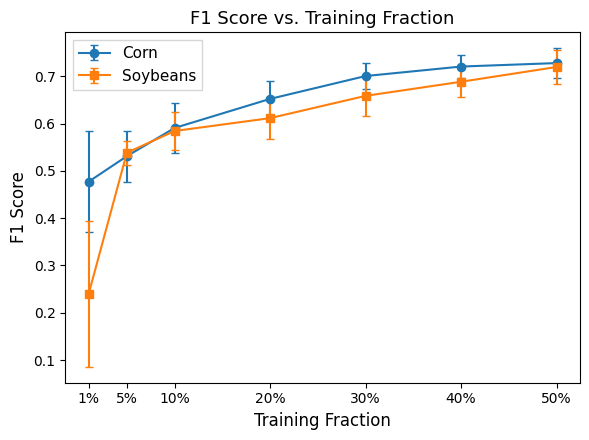
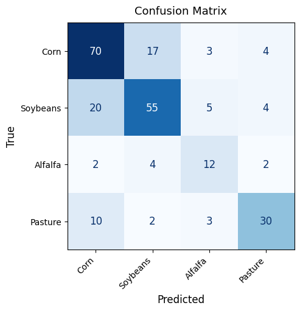
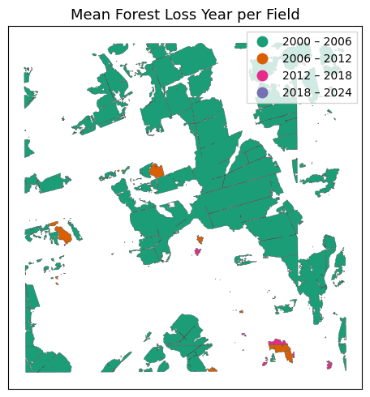
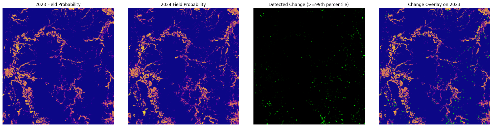

<div align="center">

# 🌾 Fields of The World

### A Field Guide for Extracting Agricultural Field Boundaries

**Official repository for the [ICLR 2026 ML4RS Workshop](https://ml-for-rs.github.io/iclr2026/) tutorial paper**

[](https://arxiv.org/abs/2602.08131)
[](https://ml-for-rs.github.io/iclr2026/)
[](https://github.com/fieldsoftheworld/iclr2026-ml4rs-tutorial/actions/workflows/ci.yml)
[](LICENSE)
[](https://fieldsofthe.world)

[Isaac Corley](https://github.com/isaaccorley) · [Hannah Kerner](https://github.com/hannah-rae) · [Caleb Robinson](https://github.com/calebrob6) · [Jennifer Marcus](https://github.com/jen-marcus-taylorgeospatial)



<sub>Country-scale FTW inference over Japan, streamed directly from cloud-optimized Zarr on Source Cooperative.</sub>

</div>

______________________________________________________________________

## Overview

Field boundary maps are a building block for agricultural data products like crop monitoring, yield estimation, and deforestation screening. This tutorial walks through the [Fields of The World (FTW)](https://fieldsofthe.world) ecosystem, which includes a benchmark of **1.6M field polygons across 24 countries**, pre-trained segmentation models, and the [`ftw-tools`](https://github.com/fieldsoftheworld/ftw-baselines) command line interface for inference.

The two notebooks cover:

1. **Local-scale field boundary extraction**: download bi-temporal Sentinel-2 imagery for any MGRS tile, run FTW inference, polygonize the predictions, then use the polygons for few-shot crop type mapping with MOSAIKS features and parcel-level forest loss attribution with Hansen GFC.
1. **Country-scale exploration**: query pre-computed FTW predictions for five countries (4.76M km²) stored as cloud-optimized Zarr, and run year-over-year agricultural change detection without re-running inference.

## Notebooks

|     | Notebook                                                                                           | What you'll do                                                                                      |                                                                                                                                                                                                                              |
| :-: | :------------------------------------------------------------------------------------------------- | :-------------------------------------------------------------------------------------------------- | :--------------------------------------------------------------------------------------------------------------------------------------------------------------------------------------------------------------------------: |
| 1️⃣  | [**Agriculture monitoring with FTW**](1.0-agriculture-monitoring-with-ftw.ipynb)                   | Sentinel-2 download → FTW inference → polygons → crop type classification → forest loss attribution |     [](https://colab.research.google.com/github/fieldsoftheworld/iclr2026-ml4rs-tutorial/blob/main/1.0-agriculture-monitoring-with-ftw.ipynb)      |
| 2️⃣  | [**Country-scale field boundary predictions**](2.0-country-scale-field-boundary-predictions.ipynb) | Stream country-scale mosaics + predictions from Zarr → change detection → vectorize                 | [](https://colab.research.google.com/github/fieldsoftheworld/iclr2026-ml4rs-tutorial/blob/main/2.0-country-scale-field-boundary-predictions.ipynb) |

## Highlights

### 🗺️ From pixels to parcels



The full local pipeline is four commands, from bi-temporal Sentinel-2 scenes to vector field boundaries. Shown on the right are FTW polygons for MGRS tile `14TPN` in Iowa, USA.

```bash
pip install ftw-tools

# Download bi-temporal Sentinel-2 imagery and run inference
ftw inference download --win_a <id1> --win_b <id2> --out input.tif --bbox <bbox>
ftw inference run input.tif --out preds.tif --model FTW_PRUE_EFNET_B3_CCBY

# Filter by land cover and polygonize
ftw inference filter-by-lulc preds.tif --out filtered.tif
ftw inference polygonize filtered.tif --out boundaries.gpkg
```

<br clear="right"/>

### 🌽 Few-shot crop type mapping

MOSAIKS random convolutional features pooled within each FTW polygon, plus a logistic regression trained on USDA Cropland Data Layer labels, reach **macro F1 of 0.65–0.75**. Training on only 10% of labeled fields lands within 5% of full-data performance.

<p align="center">
  
  
  
</p>

### 🌳 Forest loss attribution



Joining FTW polygons with Hansen Global Forest Change loss-year rasters gives per-field zonal statistics (mean / min / max loss year). This flags parcels with recent clearing, which is relevant for EU Deforestation Regulation (EUDR) compliance after 2020. The example uses MGRS tile `21LXF` in Mato Grosso, Brazil.

<br clear="right"/>

### 🗾 Country-scale change detection

Pre-computed predictions are available for **Japan, Mexico, Rwanda, South Africa, and Switzerland** across two seasons and two years (2023–2024). The Zarr archives hold both Sentinel-2 mosaics and raw softmax probabilities, so you can lazily query any extent and difference years to find agricultural expansion or abandonment.

<p align="center">
  
</p>

## Installation

The notebooks need Python 3.12 or 3.13. Using conda:

```bash
git clone https://github.com/fieldsoftheworld/iclr2026-ml4rs-tutorial.git
cd iclr2026-ml4rs-tutorial

conda env create -f environment.yml
conda activate ftw-tutorial
```

Or with plain `pip` in a virtual environment:

```bash
PIP_CONSTRAINT=constraints.txt pip install .
```

Then launch Jupyter and open either notebook:

```bash
pip install jupyter
jupyter lab
```

> [!TIP]
> Notebook 1 runs inference on CPU, CUDA, or Apple Silicon (MPS) and picks whichever is available. A GPU is not required, it just makes the inference step faster.

## Development

```bash
pip install -e '.[dev]'
pre-commit install
pre-commit run --all-files
```

CI runs `pre-commit` and executes both notebooks end-to-end on Ubuntu, macOS, and Windows.

## Citation

If you find this tutorial useful, please cite:

```bibtex
@inproceedings{corley2026ftwtutorial,
  title     = {Fields of The World: A Field Guide for Extracting Agricultural Field Boundaries},
  author    = {Corley, Isaac and Kerner, Hannah and Robinson, Caleb and Marcus, Jennifer},
  booktitle = {ICLR 2026 Workshop on Machine Learning for Remote Sensing (ML4RS)},
  year      = {2026},
  eprint    = {2602.08131},
  archivePrefix = {arXiv},
  url       = {https://arxiv.org/abs/2602.08131}
}
```

and the original FTW benchmark:

```bibtex
@inproceedings{kerner2025ftw,
  title     = {Fields of The World: A Machine Learning Benchmark Dataset For Global Agricultural Field Boundary Segmentation},
  author    = {Kerner, Hannah and Chaudhari, Snehal and Ghosh, Aninda and Robinson, Caleb and Ahmad, Adeel and Choi, Eddie and Jacobs, Nathan and Holmes, Chris and Mohr, Matthias and Dodhia, Rahul and Lavista Ferres, Juan M. and Marcus, Jennifer},
  booktitle = {Proceedings of the AAAI Conference on Artificial Intelligence},
  pages     = {28151--28159},
  year      = {2025}
}
```

## Related

- 🌍 [fieldsofthe.world](https://fieldsofthe.world): project homepage, dataset, and global predictions
- 🛠️ [ftw-baselines](https://github.com/fieldsoftheworld/ftw-baselines): models, training code, and the `ftw-tools` CLI
- 📦 [Source Cooperative](https://source.coop/wherobots/fields-of-the-world): country-scale mosaics and predictions used in notebook 2

## License

Code is released under the [Apache 2.0 License](LICENSE).
